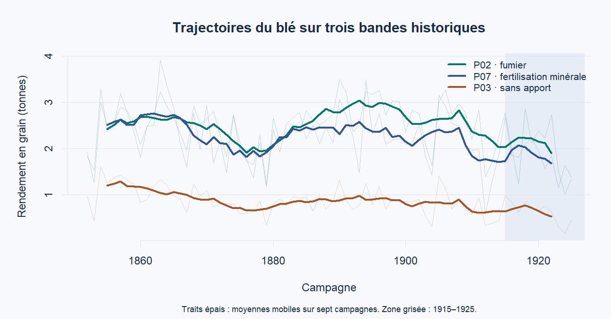
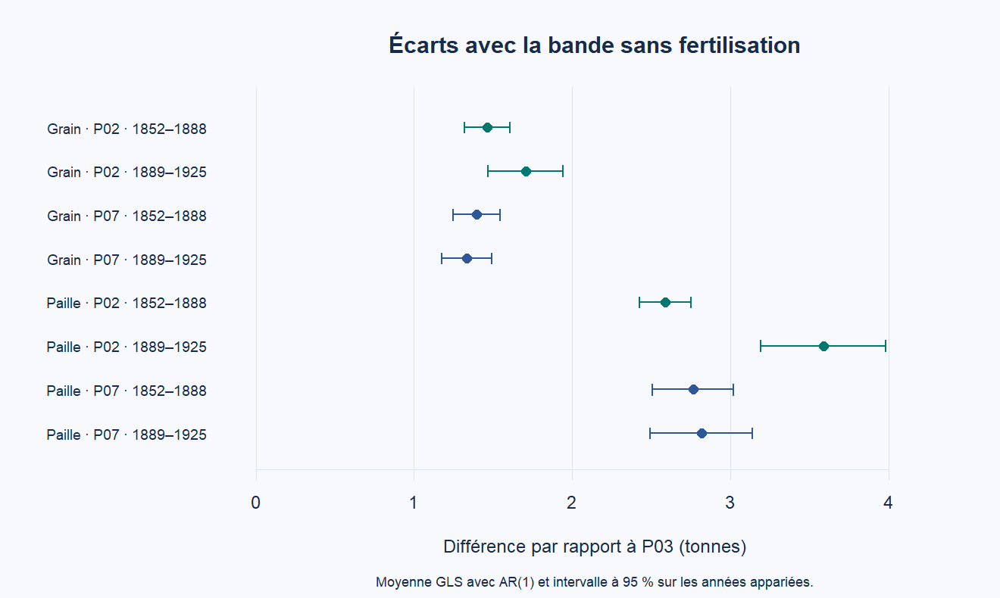
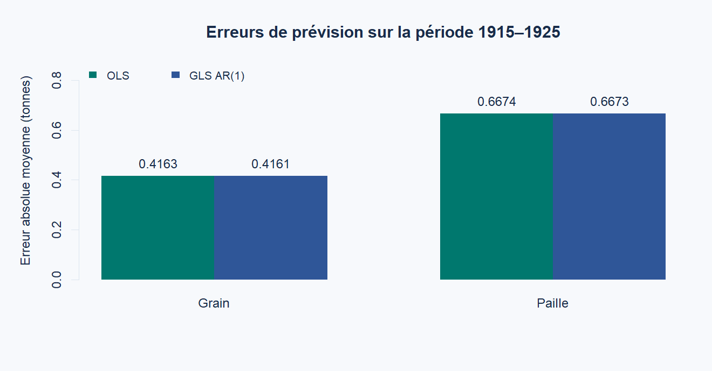

# Broadbalk Longitudinal Trial Analysis

L’analyse couvre **1 258 observations de 17 bandes**, soit 74 campagnes historiques de 1852 à 1925. La bande avec fumier P02 présente un rendement en grain supérieur à P03 de **1,577 tonne** en moyenne selon le modèle GLS à erreurs AR(1), avec un intervalle à 95 % de **1,425 à 1,729**. La comparaison est descriptive et porte sur des bandes historiques fixes.







## Résultats

| Résultat | N observations test | MAE OLS | MAE GLS AR(1) |
| --- | ---: | ---: | ---: |
| Grain | 187 | 0,4163 | 0,4161 |
| Paille | 187 | 0,6674 | 0,6673 |

L’ajustement AR(1) change peu l’erreur sur les onze dernières campagnes. Le test concerne les bandes déjà observées avant 1915. Les intervalles portent sur le contraste temporel entre des bandes précises. La parcelle, l’apport et les changements historiques peuvent influer sur ces écarts. Les unités reprennent celles du dictionnaire agridat.

Le [rapport Quarto](report.html) explique les écarts, le contrôle de couverture et le découpage. Les tableaux sont fournis pour la [couverture](reports/coverage.csv), les [contrastes appariés](reports/contrasts.csv) et les [erreurs de validation](reports/scores.csv).

## Reproduire

```text
python fetch_broadbalk.py
Rscript tests/test_analysis.R
Rscript analysis.R
Rscript plot_results.R
quarto render report.qmd
```

Dépendances de calcul. R avec le paquet recommandé `nlme`, Python 3.11+ et Quarto 1.11.9. Le fichier source est téléchargé et contrôlé par SHA-256. Les tableaux et figures du dépôt sont issus de cette révision.

## Source

La réanalyse utilise le fichier historique du même essai distribué par agridat et attribué à Andrews et Herzberg (1985). Son périmètre couvre 1852–1925. Le jeu e-RA moderne couvre 1968–2022 et possède une demande de téléchargement distincte. Les mesures originales restent locales. [Fichier historique épinglé](https://github.com/kwstat/agridat/blob/d9fd2abaa3ebc925c10b05cd1aa4758d013c47a7/data/broadbalk.wheat.txt) · [Documentation agridat](https://cran.r-project.org/package=agridat) · [Rothamsted Broadbalk](https://www.era.rothamsted.ac.uk/Broadbalk)
