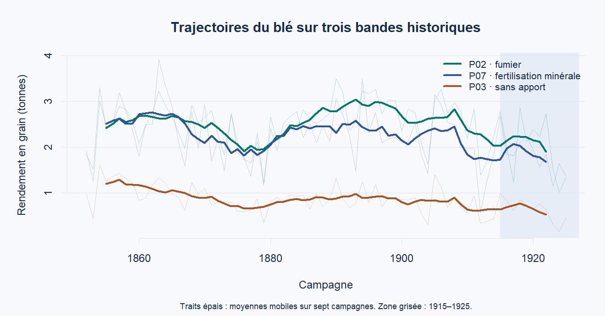
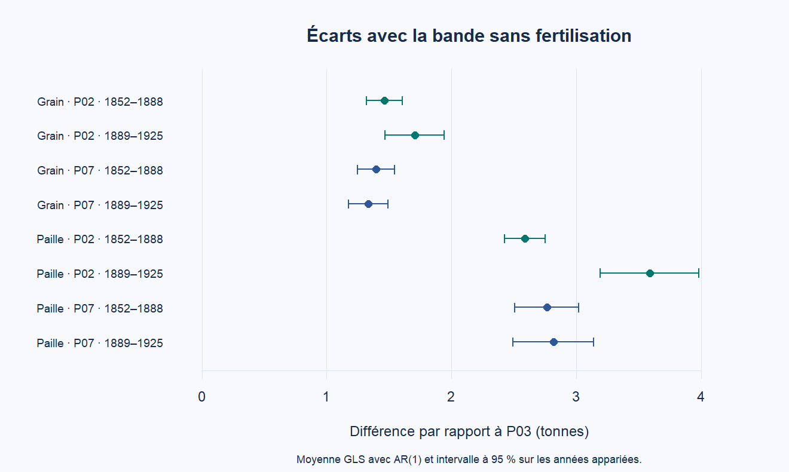
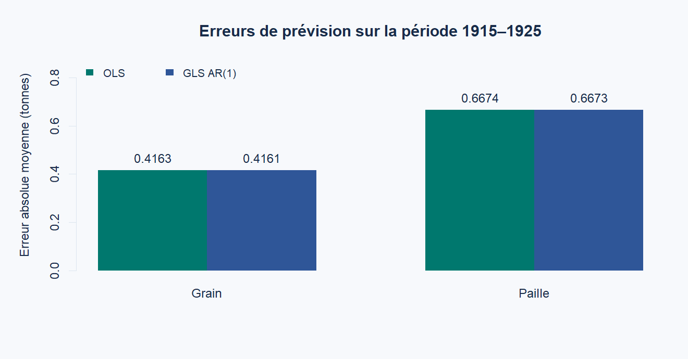

## Périmètre

Les observations proviennent de la table historique Broadbalk distribuée par agridat. L’analyse décrit les bandes de cette expérience. Chaque bande porte des traitements historiques qui peuvent varier selon l’année. La comparaison entre deux bandes décrit un écart et n’identifie pas un effet causal.

## Trajectoires

## Écarts appariés

La comparaison soustrait le rendement de la bande P03 de celui de P02 ou P07 pour chacune des années communes. L’ajustement GLS estime un contraste moyen avec des erreurs autorégressives de premier ordre.

## Validation hors période

Les modèles utilisent le même intercept et la même tendance linéaire propres à chaque bande. OLS suppose des erreurs indépendantes. GLS ajoute une structure AR(1) par bande. Le test concerne les années 1915–1925 et les bandes observées à l’entraînement.

| Fichier | Contenu |
| --- | --- |
| [Couverture](reports/coverage.csv) | Effectifs et années du jeu historique |
| [Écarts](reports/contrasts.csv) | Moyennes et intervalles à 95 % par période |
| [Validation](reports/scores.csv) | MAE et RMSE par résultat et modèle |

[Documentation agridat](https://cran.r-project.org/web/packages/agridat/refman/agridat.html) · [Rothamsted Broadbalk](https://www.era.rothamsted.ac.uk/Broadbalk)
